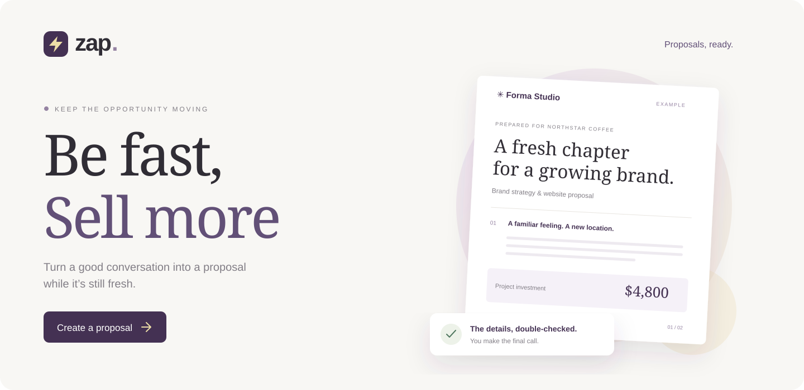

# Zap

Zap helps small service teams turn a customer conversation into a proposal. Save your company’s experience and customer context once, describe the work, and get a draft to review and export as a Word document.

## How it works

1. **The opportunity:** select a customer and describe their needs, your deliverables, and what’s outside the scope.
2. **The details:** add dates, pricing, and payment terms.
3. **Review:** generate a draft, edit it, check the commitments, and export it after approval.

Zap supports services and partnership proposals. You can save versions and resume unfinished work, including from another browser connected to the same local app.

## Run locally

You’ll need **Node.js 22+**, **Python 3.11+**, and a **Crusoe Intelligence API key** for AI drafting. You can explore the app and example brief without a key.

```sh
python3 -m venv .venv
.venv/bin/python -m pip install -r backend/requirements.lock.txt
npm --prefix frontend ci
cp .env.example .env
```

Add your key to `CRUSOE_API_KEY` in `.env`, then start both servers:

```sh
./scripts/start.sh
```

Open [127.0.0.1:3000](http://127.0.0.1:3000). The landing page is at `/`; the workspace is at `/app`. Stop both servers with **Ctrl+C**.

## Crusoe integration

The Python backend sends the company context and proposal brief to **Crusoe Serverless Inference**, using `openai/gpt-oss-120b` by default. It checks the response and can request up to two revisions. The API key stays on the server. This uses an existing model; it does not fine-tune one.

Zap calculates prices in code and preserves scope, dates, exclusions, and commercial terms from the brief. Checks flag missing information, changed commitments, and some unsupported claims. You still need to review the proposal before exporting. Nothing is sent to the customer automatically.

The default limits are **$4 in estimated usage** and **60 model calls**. Configure these and the token rates in `.env`. The estimate tracks this app’s requests; check Crusoe billing for actual spend.

## Development

| Path | Contents |
| --- | --- |
| `frontend/` | Next.js, React, and TypeScript UI |
| `backend/` | FastAPI, proposal rules, Crusoe calls, SQLite storage, and Word export |
| `backend/tests/` | API and validation tests; no live model calls |
| `scripts/` | Local launcher and optional live acceptance checks |

```sh
.venv/bin/python -m pytest backend/tests -q
npm --prefix frontend run build
```

For a production frontend build, run `npm --prefix frontend run start` after building, with the backend running separately:

```sh
.venv/bin/python -m uvicorn backend.main:app --host 127.0.0.1 --port 8000
```

`scripts/live_acceptance.py` makes paid Crusoe calls when run explicitly. It is separate from the test suite.

## Current scope

This is a local, single-workspace MVP. SQLite stores profiles, the current proposal, saved versions, and usage estimates. Another open browser needs a refresh to load newer changes; stale edits cannot overwrite a newer saved draft.

There are no accounts, team permissions, billing, e-signatures, or automatic delivery. Landing-page prices are proposed plans, and specialized model fine-tuning is a future feature.
